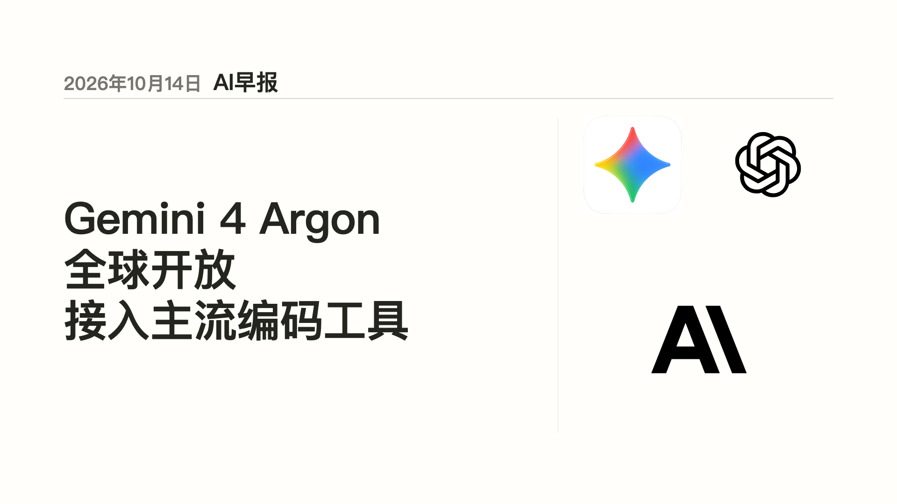
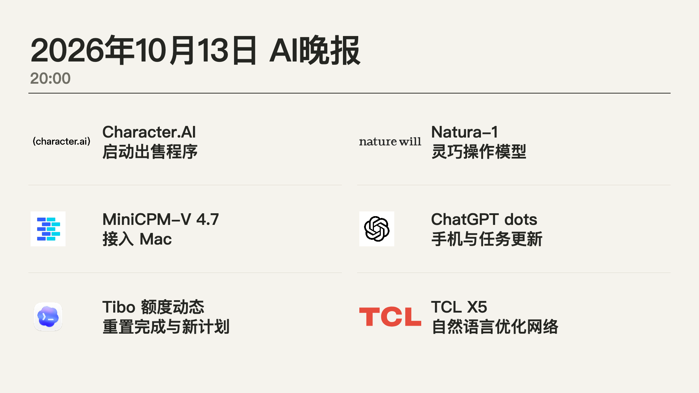
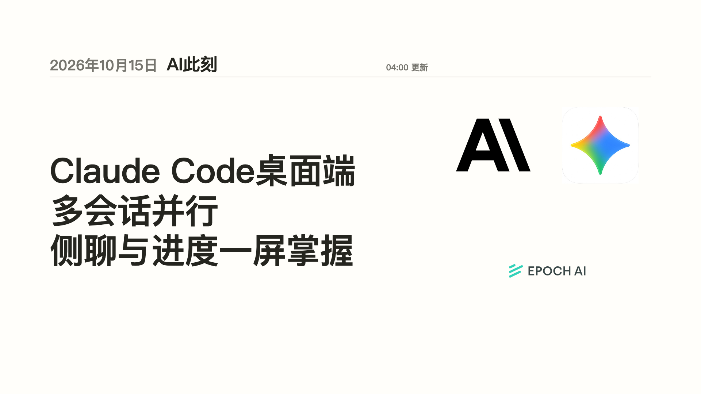
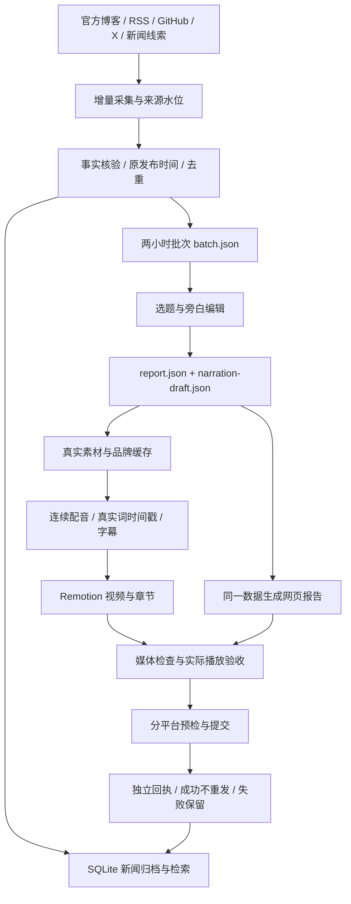

# AI Newsroom Studio · AI 每日观察

**把 AI 资讯从来源采集，做成可追溯的早报、晚报和短视频。**

来源监控 → 事实与时间核验 → 分批编辑 → 配音与字幕 → 视频 / 网页 → 按平台提交与留档

Python · React · TypeScript · Remotion · SQLite · Seed TTS · Browser publishing

[真实案例](#真实案例) · [完整流程](#完整流程) · [快速开始](#快速开始) · [代码地图](#代码地图) · [制作说明](docs/production.md) · [发布接入](docs/publishing.md)

这是一个持续制作中文 AI 新闻的实际项目。仓库包含采集、编辑数据契约、来源目录、视频工程、网页报告、质量检查和平台提交代码，也保留了项目中已经做好的真实成片。它适合研究资讯工作流、搭建自己的 AI 日报，或继续开发成编辑工作台。

来源发现和媒体制作有脚本支持；选题、事实判断、旁白编辑与最终播放检查仍由编辑者或具有浏览器能力的 Agent 完成。克隆仓库可查看案例、运行离线测试和打开视频工程；制作新一期需要准备经过核验的编辑数据，使用配音或发布服务时需要自己的账号。

## 真实案例

下面三张图都是对应成片的**原始封面**。视频、封面和字幕按原文件收录，没有为仓库重新生成演示内容。点击封面打开 MP4 文件。

### 01 · AI 早报 — 2026-10-14

[](https://raw.githubusercontent.com/kirilovamanolo490-ship-it/ai-newsroom-studio/main/examples/2026-10-14-morning/video.mp4)

约 **3 分 36 秒**，展示一个完整早报如何把多条消息组织成统一的新闻视频。

[播放 / 下载 MP4](examples/2026-10-14-morning/video.mp4) · [字幕](examples/2026-10-14-morning/subtitles.srt) · [编辑数据与来源](examples/2026-10-14-morning/reviewed-data.json)

### 02 · AI 晚报 — 2026-10-13

[](https://raw.githubusercontent.com/kirilovamanolo490-ship-it/ai-newsroom-studio/main/examples/2026-10-13-evening/video.mp4)

约 **3 分 10 秒**，展示晚间汇总的章节安排、连续旁白、字幕和消息来源说明。

[播放 / 下载 MP4](examples/2026-10-13-evening/video.mp4) · [字幕](examples/2026-10-13-evening/subtitles.srt) · [编辑数据与来源](examples/2026-10-13-evening/reviewed-data.json)

### 03 · AI 此刻 — 2026-10-15 04:00

[](https://raw.githubusercontent.com/kirilovamanolo490-ship-it/ai-newsroom-studio/main/examples/2026-10-15-briefing-0400/video.mp4)

约 **1 分 22 秒**，展示两小时批次的短版。仓库中的 `DailyReport` 默认预览也使用这一期的数据与素材。

[播放 / 下载 MP4](examples/2026-10-15-briefing-0400/video.mp4) · [字幕](examples/2026-10-15-briefing-0400/subtitles.srt) · [编辑数据与来源](examples/2026-10-15-briefing-0400/reviewed-data.json)

详细记录见 [案例说明](examples/README.md) 和 [文件摘要清单](examples/cases.json)。它们记录本地成片与保存的验收状态；此处不把历史提交记录当作当前社交平台的上线证明。视频中的新闻事实、产品状态和时间范围以对应期次为准。

## 完整流程



| 环节 | 实际做的事 | 主要产物 |
| --- | --- | --- |
| 来源管理 | 公开来源目录、官方优先、不同来源独立采集频率 | `sources/*.json` |
| 增量采集 | RSS、网页、GitHub、X；失败保留水位和翻页游标 | 来源快照、变化列表、覆盖缺口 |
| 编辑核验 | 区分发布时间、更新时间、发现时间；复核事实、图像和引用 | 经审核的 `batch.json`、`report.json` |
| 期次安排 | 两小时一个批次；08:00 / 20:00 汇总早晚报，其余十个偶数时点制作短版 | 每日 12 个视频槽位的计划 |
| 配音字幕 | 每场连续合成；使用服务返回的真实词时间戳 | 旁白、音频、SRT、时间轴 |
| 视频与网页 | 同一报告指纹驱动封面、正文、章节与网页 | 1920×1080 / 30fps MP4、HTML |
| 完成检查 | 检查视频、音轨、字幕、章节、素材与实际播放记录 | 文件哈希、验收回执 |
| 平台提交 | B站、抖音、小红书、YouTube 按已绑定账号分别执行 | 每个平台独立结果与恢复状态 |

来源库在 **2026-10-15 的本次快照**中收录 615 个来源条目；监控清单有 421 项配置，其中 414 项启用。目录验证、采集启用和每次实际抓取成功是三个不同状态；这些数字不表示所有来源随时可用。来源库的出处与维护规则见 [来源库维护说明](sources/来源库维护说明.md)。

## 快速开始

### 1. 下载仓库并查看真实成品

```sh
git clone https://github.com/kirilovamanolo490-ship-it/ai-newsroom-studio.git
cd ai-newsroom-studio
python3 -m http.server 8090 --bind 127.0.0.1 --directory examples
```

打开 `http://127.0.0.1:8090/` 可查看三期视频、字幕入口与来源说明。播放现有案例无需 API 密钥或 Node 依赖。

### 2. 安装核心 Python 依赖并运行离线检查

推荐 **Python 3.12、Node.js 22+**。采集和发布脚本使用 Unix 文件锁，当前运行基线是 macOS；Linux 可按下面的依赖与媒体工具配置使用，Windows 原生流程尚未验证。

```sh
python3.12 -m venv .venv
source .venv/bin/activate
python -m pip install -r requirements.txt
python -m unittest discover -s tools -p 'test_*.py'
python tools/news_batch.py plan --scheduled-for 2026-10-15T04:00:00+08:00
python scripts/verify_examples.py
```

测试与批次计划不会调用配音，也不会上传视频。案例校验会核对文件 SHA-256 和字幕；安装 FFprobe 后还会检查时长、分辨率与音轨。

### 3. 打开真实 Remotion 工程

```sh
cd prototypes/daily-brief-video
npm ci
npx tsc --noEmit
npm run dev -- --no-open
```

打开终端给出的本地 Studio 地址。`DailyReport` 对应 2026-10-15 04:00 的真实短版，`Briefing1600` 保留 2026-10-13 16:00 的另一份实际制作数据。两期需要的图片、片段和音频已经随工程收录；播放这两份现有工程无需再次合成配音。

如需重新导出默认案例：

```sh
npx remotion render DailyReport out/demo.mp4
```

视频渲染需要浏览器与中文字体。浏览器路径可以通过 `REMOTION_CHROME_EXECUTABLE` 配置；具体环境变量和媒体工具安装见 [安装说明](docs/setup.md)。重新渲染受字体、浏览器和编码器版本影响，不保证与保存的 MP4 字节一致。

## 制作自己的一期

1. 维护自己的来源清单，采集并检查抓取缺口。
2. 核对消息事实、原发布时间、素材与来源，保存审核后的批次和报告。
3. 编辑简洁的原创旁白，确认消息顺序与导航一致。
4. 配置自己的配音服务，生成视频、字幕、封面和网页。
5. 实际播放检查，完成同一期的验收记录后再进入平台提交。

详见 [制作说明](docs/production.md)、[完整制作链路](research/report-redesign/完整制作链路.md) 和 [早晚报制作规范](research/report-redesign/早晚报制作规范.md)。原制作规范保留了项目迭代背景；公开版的安装路径与命令以 `docs/` 为准。

## 代码地图

| 路径 | 职责 |
| --- | --- |
| [`tools/source_watch.py`](tools/source_watch.py) | 增量读取、时间水位、失败重试与翻页恢复 |
| [`tools/juya_sources.py`](tools/juya_sources.py)、[`juya_platforms.py`](tools/juya_platforms.py) | 来源线索发现、公开链接和平台目录整理 |
| [`tools/news_batch.py`](tools/news_batch.py) | 两小时批次规划、早晚报汇总与覆盖缺口 |
| [`tools/news_archive.py`](tools/news_archive.py) | 事件、版本、来源、批次与期次的 SQLite 归档 |
| [`tools/edition_contract.py`](tools/edition_contract.py) | 时间窗口、报告指纹、导航和旁白顺序契约 |
| [`tools/brand_assets.py`](tools/brand_assets.py) | 官方品牌素材缓存、来源和 SHA-256 检查 |
| [`tools/synthesize_seed_voice.py`](tools/synthesize_seed_voice.py) | 连续旁白、配音缓存、真实字幕时间戳和错误分类 |
| [`tools/produce_daily.py`](tools/produce_daily.py) | 串联本地制作阶段，复用指纹一致的已验证成片 |
| [`tools/completion_gate.py`](tools/completion_gate.py) | 同一期视频、字幕、章节和验收记录检查 |
| [`tools/social_publisher.py`](tools/social_publisher.py)、[`social_login.py`](tools/social_login.py) | 平台绑定、成片包、预检、提交、独立回执 |
| [`prototypes/daily-brief-video/`](prototypes/daily-brief-video/) | React / Remotion 场景、封面、字幕与自适应排版 |
| [`research/report-redesign/`](research/report-redesign/) | 网页报告、归档阅读页、交互与 QA 工具 |
| [`sources/`](sources/) | 公开来源库与监控清单快照 |
| [`examples/`](examples/) | 三期真实成品、字幕和可核查摘要 |
| [`third_party/`](third_party/) | 可选上传器的固定版本、修改补丁与原许可证 |

## 发布接入与状态

`tools/social_publisher.py` 是统一发布入口，可接入固定版本的 `social-auto-upload`。公开版提供关闭状态的 [配置模板](config/social-publisher.example.json)；首次运行需要自行安装上传器、配置并登录目标账号。单个平台失败不会使其他平台重复上传，未绑定平台会跳过。

`submitted_unverified` 表示已提交且未独立确认公开，`processing` 表示平台处理，`public` 表示记录中存在公开结果。代码保留原始状态；成功提交后的处理规则见 [发布接入](docs/publishing.md)。

本仓库不安装定时任务。若按 12 个视频槽位运行，需要另外部署采集、编辑与制作调度，保持运行机器在线，并为浏览器发布保留可用登录会话。

## 验证、范围与素材归属

本次公开整理的检查结果记录在 [验证记录](docs/validation.md)。代码测试、保存的案例验收和当前平台状态分别记录。

仓库保留完整核心代码与代表性真实案例；不包含运营账号凭据、Cookies、发布账号状态、原始研究网页全文、大量采集缓存、`node_modules` 和虚拟环境。约 7 GB 的运营工作区没有作为备份直接上传。

自有代码尚未另选开源许可证；公开可见不代表授予额外的再分发许可。第三方依赖遵循各自许可证。案例中的品牌标识、来源截图和新闻片段用于说明对应报道与工作流，权利仍归各自权利人，来源随案例和素材清单保留。详见 [第三方说明](THIRD_PARTY_NOTICES.md)。
